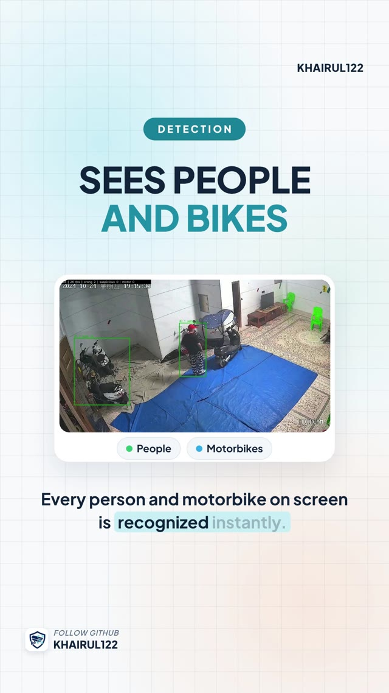

# AI CCTV Suspicious Activity Detection

A web application that watches CCTV feeds, recognizes people and motorbikes, and raises an alert with a photo when someone behaves suspiciously. It adds dedicated rules for motorbike parking lots, restricted zones with guard hours, and a one-tap review flow for staff.

<p align="center">
  
</p>

Versi Bahasa Indonesia: [README.id.md](README.id.md)

> **Availability:** this system is available for purchase under a commercial license, and the author also builds custom systems. See [Licensing and purchase](#licensing-and-purchase).

> **Responsible use:** a `suspicious` label is an alert for a person to review. It is not proof of intent or of a crime.

---

## Contents

- [Features](#features)
- [How it works](#how-it-works)
- [Model performance](#model-performance)
- [Tech stack](#tech-stack)
- [Project structure](#project-structure)
- [Requirements](#requirements)
- [Installation](#installation)
- [Configuration](#configuration)
- [Security](#security)
- [Retraining the models](#retraining-the-models)
- [Limitations](#limitations)
- [Licensing and purchase](#licensing-and-purchase)
- [Custom development](#custom-development)
- [Credits](#credits)

---

## Features

**Video sources**
- USB or laptop webcam, IP CCTV cameras over RTSP, and recorded video files (mp4, avi, mov, mkv, mpg, up to 500 MB per upload)
- Automatic reconnection when an RTSP stream drops (retry delays of 2, 4, 8, 16, then 30 seconds)

**Detection**
- People and motorbikes detected with a retrained YOLO26s model
- Each person keeps the same ID across frames with BoT-SORT and ReID, including short occlusions
- **Automatic mode:** during the first 10 seconds both rule sets run in parallel, then the system picks the general or the parking rules by itself
- **General rules:** loitering, pacing back and forth, and staying in a sensitive zone for too long
- **Parking rules:** lingering by someone else's motorbike, crouching next to a bike, vanishing behind a bike, pushing a parked bike away, a bike taken by someone who does not match the owner's appearance, and moving between several bikes
- People who are only walking past are not flagged

**Zones**
- Draw restricted, sensitive, or relaxed zones on the camera image
- Give each zone active hours, for example 10 PM to 6 AM, including ranges that cross midnight
- Zone changes apply to a running session without a restart

**Alerts and review**
- Live alert feed with a saved snapshot and an optional sound
- Staff mark each alert as **Real** or **False alarm** with one tap
- The dashboard turns those reviews into field precision, the basis for tuning thresholds on site
- Full history with filters by review status, date, and session, plus CSV export

**Web application**
- Login with sessions, a "keep me signed in" option, and password change
- Responsive layout with a bottom navigation bar on phones
- All notices shown as dialog boxes, detection alerts shown as non-blocking toasts

> The user interface is currently in Bahasa Indonesia. An English interface is available as a custom option.

## How it works

```
Camera / RTSP / video file
          │
          ▼
YOLO26s detection (person, motorcycle)
          │
          ▼
BoT-SORT + ReID tracking (stable IDs, gap linking up to 2 s)
          │
          ▼
Behavior rules (general, parking, zones with schedules)
          │
          ▼
Alert + snapshot ──► MySQL history ──► staff review ──► field precision
```

The application follows a three-tier architecture:

| Tier | Folder | Responsibility |
| --- | --- | --- |
| Presentation | `web/app/presentation` | Flask routes, templates, static assets, security middleware |
| Business | `web/app/business` | Detection engine, behavior rules, session and review services |
| Data | `web/app/data` | MySQL access through repositories, snapshot and video storage |

The detection engine has no knowledge of the database. It reports results through callbacks, so the business logic stays independent of storage.

## Model performance

Evaluated on held-out data after retraining (YOLO26s, 640 px):

| Test set | Class | mAP50 | Recall |
| --- | --- | --- | --- |
| Validation (COCO + Open Images) | person | 0.788 | 0.687 |
| Validation (COCO + Open Images) | motorcycle | 0.812 | 0.711 |
| Partially occluded people | person | 0.756 | 0.657 (was 0.450) |
| CAVIAR corridor footage | person | 0.963 | 0.910 |

Behavior classification on 8 CAVIAR test videos: F1 0.756 for `safe` and 0.800 for `suspicious`.

On the motorbike theft test video, the alert fired 18.6 seconds into the clip.

## Tech stack

- **Language:** Python 3.12
- **Detection and tracking:** Ultralytics YOLO26s, BoT-SORT with ReID
- **Web:** Flask 3, Jinja templates, vanilla JavaScript
- **Database:** MySQL or MariaDB through PyMySQL
- **Server:** waitress (32 threads)
- **Training:** Google Colab notebook with Drive caching

## Project structure

```
supicious-activity-detection/
├── web/                      Flask application (detailed guide: web/README.md, Indonesian)
│   ├── app/                  presentation, business, and data tiers
│   ├── models/               model weights: best.pt (general), motor.pt (parking)
│   ├── trackers/             BoT-SORT configuration
│   ├── database/             SQL schema
│   ├── storage/              videos, alert snapshots, logs, session key (not distributed)
│   ├── tests/                automated tests
│   └── run.py                application entry point
├── notebook/                 Colab training notebook
├── dataset/                  corrected CAVIAR person dataset
├── hasil_latih/              training outputs and the model card
├── dokumen/                  presentation, logo, portfolio videos
└── Buka web deteksi.cmd      one-click launcher for Windows
```

## Requirements

- Windows 10 or 11 (tested). Linux works with the manual commands below.
- Python 3.12
- MySQL 8 or MariaDB 10.6 or newer (Laragon is the simplest option on Windows)
- 8 GB RAM recommended. An NVIDIA GPU is optional and speeds up live analysis.
- The model weights `best.pt` and `motor.pt` in `web/models/` (included with a purchased license)

## Installation

**Windows, one click**

1. Start MySQL. In Laragon, click **Start All**.
2. Double-click `Buka web deteksi.cmd`. It installs missing packages and opens `http://127.0.0.1:5000`.
3. On the first visit, create the admin account.

**Manual (PowerShell or a terminal)**

```powershell
python -m venv .venv
.\.venv\Scripts\python.exe -m pip install -r web\requirements.txt
.\.venv\Scripts\python.exe web\run.py --buka
```

The application creates the `deteksi_perilaku` database and its tables on first start.

**Useful options for `web/run.py`**

| Option | Purpose |
| --- | --- |
| `--host 0.0.0.0` | Allow access from the local network, for example from staff phones |
| `--port 5000` | Change the port |
| `--buka` | Open the browser automatically |
| `--atur-ulang-sandi NAME` | Reset a user's password from the server terminal |
| `--log-level DEBUG` | Show per-person details in the progress log |
| `--server-dev` | Use the Flask development server instead of waitress |

Run the tests with:

```powershell
.\.venv\Scripts\python.exe -m unittest discover -s web/tests
```

## Configuration

All settings are optional environment variables:

| Variable | Default | Purpose |
| --- | --- | --- |
| `SAD_DB_HOST` | `127.0.0.1` | MySQL host |
| `SAD_DB_PORT` | `3306` | MySQL port |
| `SAD_DB_USER` | `root` | MySQL user |
| `SAD_DB_PASSWORD` | empty | MySQL password |
| `SAD_DB_NAME` | `deteksi_perilaku` | Database name |
| `SAD_SECRET_KEY` | generated and stored in `web/storage/.kunci_session` | Session signing key |
| `SAD_COOKIE_AMAN` | `0` | Set to `1` behind HTTPS to mark cookies as secure |
| `SAD_STORAGE` | `web/storage` | Storage folder |
| `SAD_VIDEO_DIR` | `web/storage/video` | Folder for video files |
| `SAD_MODEL` | `web/models/best.pt` | General detection model |
| `SAD_MODEL_PARKIR` | `web/models/motor.pt` | Parking lot model |
| `SAD_TRACKER` | `web/trackers/botsort_reid_b125.yaml` | Tracker configuration |
| `SAD_CONFIDENCE` | `0.15` | Person detection confidence |
| `SAD_IMAGE_SIZE` | `640` | Inference image size |
| `SAD_SAMBUNG_DETIK` | `2.0` | Maximum gap in seconds for re-linking a lost ID |
| `SAD_PARKIR_DEKAT_S` | `15` | Seconds near another person's motorbike before an alert |

## Security

- Passwords hashed with PBKDF2-SHA256 at 600,000 iterations
- Account lockout for 15 minutes after 5 failed logins, with the same error message for wrong users and wrong passwords
- Rate limits per IP address: 10 login attempts per 10 minutes, 600 requests per minute, 20 uploads per hour, 4 live streams
- CSRF token on every form and on every JavaScript request
- Content Security Policy with per-request nonces and standard security headers
- HttpOnly session cookies with an 8-hour idle limit, and sign-out of old sessions after a password change
- Parameterized SQL queries throughout
- Upload validation by file content, not only by extension
- Open redirect protection and a honeypot field against form bots
- The server listens on `127.0.0.1` by default. For access from outside the local network, put HTTPS in front of it and set `SAD_COOKIE_AMAN=1`.

The project passed all 29 of its own attack tests and its 56 automated unit tests.

## Retraining the models

1. Upload the dataset, the baseline models, and the test videos to `MyDrive/supicious-activity-detection/`.
2. Open `notebook/Latih_Semua_Model.ipynb` in Google Colab and choose **Runtime > Run all**. Downloads and checkpoints are cached on Drive, so an interrupted run resumes where it stopped.
3. Download `model_web.zip`, then copy the models marked `LAYAK PASANG` (ready to deploy) into `web/models/`.

## Limitations

- The training data does not yet include footage from customer sites. Thresholds should be tuned with staff reviews after installation.
- Night performance was tested with simulated low light, not with real infrared footage.
- Detection quality depends on camera angle, resolution, and lighting.
- Recording people with CCTV is regulated. The operator is responsible for following local privacy law, for example Indonesia's Personal Data Protection Law (UU No. 27 Tahun 2022) or the GDPR.

## Licensing and purchase

This repository is **not open source**. The source code, interface, and documentation are © 2026 Khairul and are licensed under a commercial license. See [LICENSE.md](LICENSE.md).

| License | For | Includes |
| --- | --- | --- |
| Evaluation | Testing before buying | 30 days, non-production use only |
| Single-Site | One business at one location | Production use on one server, unlimited cameras at that site |
| Multi-Site | One business with several locations | Production use at the locations listed in the order |
| Developer | Integrators and agencies | Deploying the system for your own clients, with written approval |

Every paid license includes the model weights, installation help, and 30 days of email support. Paid installation, on-site setup, and extended support are available.

Third-party components keep their own licenses. Read [THIRD_PARTY_NOTICES.md](THIRD_PARTY_NOTICES.md) before deploying, especially the section on Ultralytics.

**To buy a license,** contact the author through the freelance platform where you found this project, or through GitHub: [github.com/Khairul122](https://github.com/Khairul122).

## Custom development

I also build systems to order:

- Changes to this system: new behavior rules, other object classes, an English interface, notifications to Telegram or WhatsApp, multi-camera dashboards
- Other computer vision systems: counting, attendance, PPE detection, license plates
- Web applications and dashboards with Laravel, NestJS, React, Flutter, or Python

Contact me with a short description of your needs, and I will reply with a scope and an estimate.

## Credits

- Detection and tracking: [Ultralytics](https://github.com/ultralytics/ultralytics) (AGPL-3.0 or Ultralytics Enterprise License)
- Training data: COCO 2017, Open Images V7, and the CAVIAR dataset (EC Funded CAVIAR project/IST 2001 37540)
- Parking rule "near another person's motorbike" based on Adeel et al. (2026)
- Synthetic occlusion augmentation based on Ghiasi et al., CVPR 2021
- Font: Plus Jakarta Sans (SIL Open Font License). Icons: Lucide (ISC License).

Full attributions are listed in [THIRD_PARTY_NOTICES.md](THIRD_PARTY_NOTICES.md).
